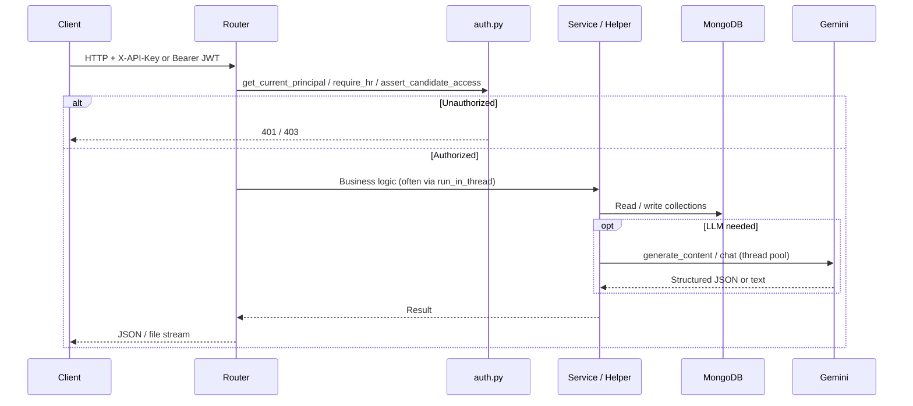
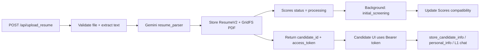
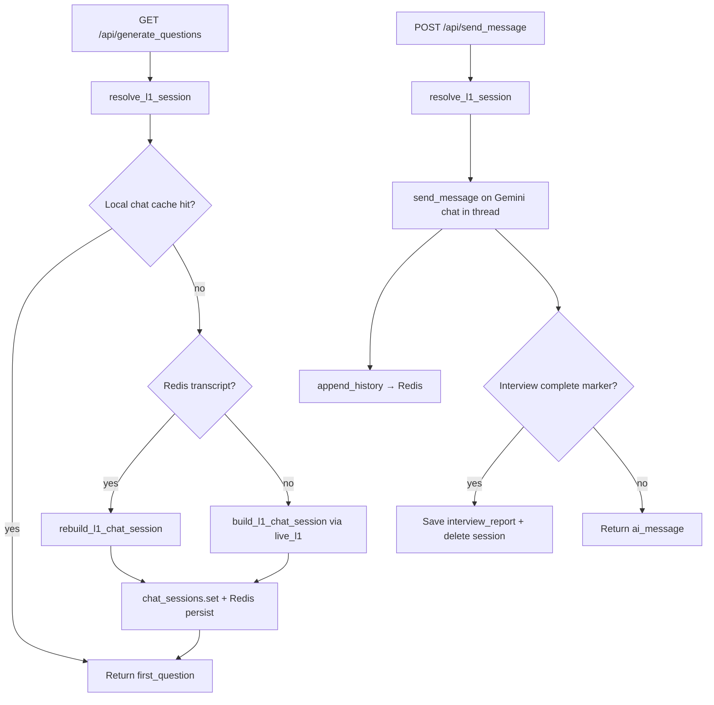
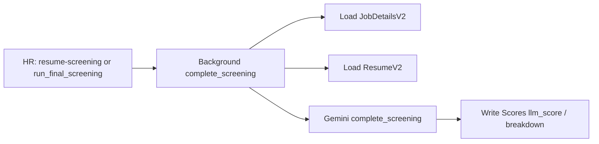
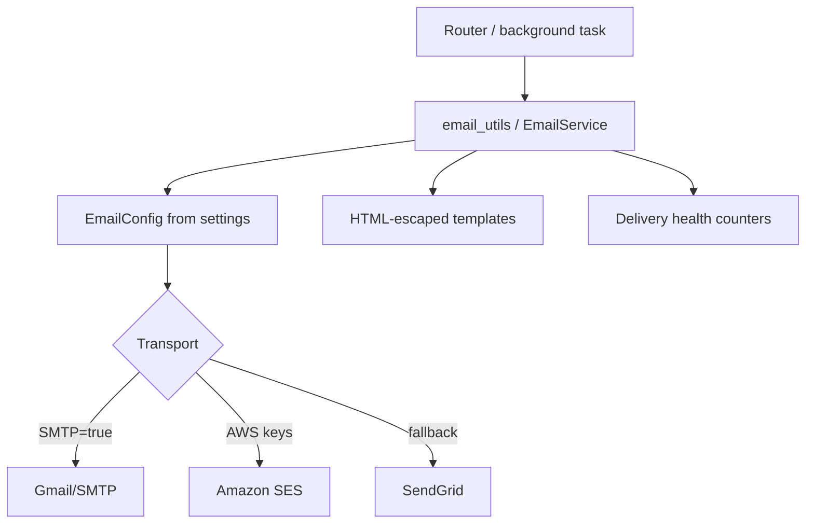

# Screening Assist — Architecture Diagram

This document describes the system architecture and primary data flows for the Screening Assist API as implemented today.

---

## High-level system view

```mermaid
flowchart TB
  subgraph Clients
    FE[Career site / Candidate UI]
    HRUI[HR / Recruiter UI]
  end

  subgraph API["Screening Assist API (FastAPI)"]
    MAIN[main.py]
    FACTORY[app/factory.py]
    AUTH[app/auth.py]
    ROUTERS[app/routers/*]
    SVC[app/services/screening.py]
    LLM[app/llm/gemini_client.py]
    EMAIL[app/email/service.py]
    SESS[app/chat_sessions.py]
    SETTINGS[app/settings.py]
  end

  subgraph External
    MONGO[(MongoDB Atlas)]
    GRID[GridFS]
    GEMINI[Google Gemini API]
    REDIS[(Redis - optional)]
    SMTP[SMTP / SES / SendGrid]
  end

  FE --> ROUTERS
  HRUI --> ROUTERS
  MAIN --> FACTORY --> ROUTERS
  ROUTERS --> AUTH
  ROUTERS --> SVC
  ROUTERS --> LLM
  ROUTERS --> EMAIL
  ROUTERS --> SESS
  FACTORY --> SETTINGS
  SVC --> MONGO
  ROUTERS --> MONGO
  ROUTERS --> GRID
  LLM --> GEMINI
  SESS --> REDIS
  EMAIL --> SMTP
  SETTINGS -. env / .env .-> SETTINGS
```

---

## Application package layout

```text
main.py                      Thin ASGI entry (create_app)
app/
  factory.py                 App factory: CORS, rate limit, routers, startup ping
  settings.py                All config from environment (pydantic-settings)
  auth.py                    API key + JWT + candidate scope checks
  database.py                MongoDB pool + GridFS
  schemas.py                 Pydantic request contracts
  helpers.py                 PDF/DOCX extract, ICS, LibreOffice convert
  chat_sessions.py           L1 session LRU/TTL + Redis transcript
  rate_limit.py              SlowAPI limiter
  routers/                   HTTP endpoints by domain
    system.py                Health, auth token, prompts
    resumes.py               Upload resume / cover letter
    candidates.py            Candidate PII & listings
    screening.py             Scores, L1 chat, L2 questions
    jobs.py                  Job CRUD / public career list
    feedback.py              Notes & L2 feedback
    files.py                 GridFS downloads
    email_api.py             Notifications & calendar mock
  services/
    screening.py             Initial/final screening pipelines, L1 session resolve
  llm/
    base.py                  ScreeningLLM protocol
    gemini_client.py         GeminiAPI (7+ LLM methods)
    schemas.py               Structured output schemas
    retry.py                 Timeout + retries
    prompt_safety.py         Interview-email field sanitization
    errors.py                LLM error types
  email/
    config.py                EmailConfig from settings
    service.py               SMTP / SES / SendGrid + health
    templates.py             HTML-escaped templates
    results.py               DeliveryResult
prompts/*.md                 System prompts (resume, jd, initial, l1_v3, …)
gemini_utils.py              Re-export of GeminiAPI (compat)
email_utils.py               Re-export of email helpers (compat)
sp_manager.py                SystemPromptManager
```

---

## Request path (typical authenticated call)



---

## Candidate apply & initial screening flow



---

## L1 live interview session flow



---

## Final / complete screening flow



---

## Email notification path



---

## Data stores

| Store | Role |
|-------|------|
| **MongoDB** | Jobs, resumes (JSON), candidates, scores, screening Q&A, feedback, notes |
| **GridFS** | Binary resumes and cover letters |
| **Redis (optional)** | Serialized L1 interview transcripts for multi-instance rebuild |
| **In-process memory** | Live Gemini chat objects (not serializable) with TTL/LRU |

Without Redis, L1 interviews require sticky sessions to one API instance. With `REDIS_URL` set, another instance can rebuild the chat from the transcript.

---

## Security boundaries

```text
Public surface
  ├── GET /health
  ├── POST /api/auth/token          (needs valid API_KEY in body)
  ├── POST /api/upload_resume       (rate-limited; issues candidate JWT)
  ├── GET /api/jobviewmain
  └── GET /api/jobview/{id}/onboarding

Candidate surface (Bearer candidate JWT or HR credentials)
  ├── PII read/write
  ├── Initial screening result
  └── L1 generate_questions / send_message / save answers

HR / service surface (X-API-Key or HR JWT)
  ├── Job admin & JD generation
  ├── Scores, L2, files, feedback
  ├── Email send / email health
  └── Prompt list / reload
```

Secrets never live in source code. Configuration is loaded only from environment variables via `app/settings.py` (see `.env.example`).

---

## LLM capability map

| Method (`GeminiAPI`) | Typical trigger |
|----------------------|-----------------|
| `resume_parser` | Resume upload |
| `jd_parser` | Job create / JD update |
| `initial_screening` | Post-upload background L0 |
| `live_l1` | L1 chat bootstrap / rebuild |
| `complete_screening` | Final scoring |
| `job_description_generator` | HR JD assist |
| `generate_l2_questions` | L2 question pack |
| `generate_interview_email` | Interview invite drafting |

Blocking Gemini SDK calls are offloaded with `asyncio.to_thread` / `run_in_thread`, capped by `GEMINI_MAX_CONCURRENCY`.
